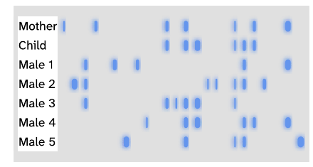
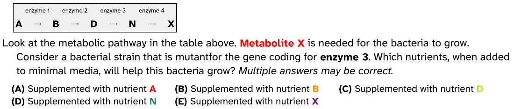
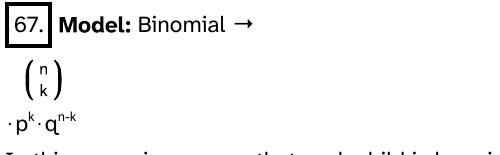
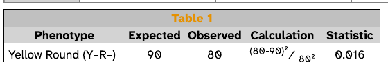

# Genetics exam HTML repair audit

Audit date: 2026-10-12. This is a repair handoff; no generator or renderer repairs
are included.

Scope is limited to HTML that demonstrably displays incorrectly or makes exam
content difficult to read. Lint, style-policy enforcement, and new validation
gates are out of scope. Invalid markup matters here only when it explains an
observed display problem.

## Decisions and priorities

Four BP repair groups affect five selected tasks. Fix the shared gel helper first:
the bands carry the evidence students must interpret. Next correct the pathway
colors and binomial model structure. Address the demonstrated text contrast
problems with small palette changes.

| ID | Priority | Tasks | BP-owned repair |
| --- | --- | --- | --- |
| BP1 | High | T17, T18 | Darken gel bands while preserving realistic blurred edges |
| BP2 | High | T02 | Emit valid CSS colors and consistent metabolite mapping |
| BP3 | Medium | T39 | Emit the whole binomial model as one valid visual unit |
| BP4 | Medium | T02, T48 | Make visibly faint labels readable |

The other 49 task samples need no identified BP HTML repair under the tested
conditions. Some have a separate EF choice-layout problem or exceed the exam's
five-choice limit; neither is evidence that their HTML is defective.

**MathML and legacy code are not the demonstrated risks in this exam selection.**
None of the 54 sampled raw questions contains MathML, `mfenced`, canvas, or inline
SVG. The selected generators do not import `bptools_legacy.py`. Older HTML table
attributes alone are not grounds for a rewrite when the output remains readable.

## Scope and evidence

The selection is the 54 rows, resolving to 38 distinct scripts, in EF's
[genetics_exam1.csv](https://github.com/vosslab/exam-formatting-tools/blob/0548172246dbcda182f2035a5ee720d63c4a3504/task_files/genetics_exam1.csv).
The table below preserves resolved generators and selection arguments. YAML tasks
also identify their content bank.

For every row, generate one fresh question, retain its unchanged BBQ record and
HTML fields, then use the existing EF HTML capture, YAML, DOCX, and LibreOffice
PDF path. The combined diagnostic PDF contains 94 numbered items on 23 pages;
all 23 pages were visually inspected. It deliberately includes the five samples
that fail the normal A-E selection gate so their output can still be audited.

Five additional fresh questions exercise T02, T17, T18, and T39 with five and ten
offspring. All five were rendered and inspected. A sixth diagnostic changes only
the preserved T39 model HTML to test the proposed structure. Thus there are 59
generated questions plus one explicitly modified diagnostic, not 60 generator
samples. Focus PDFs compare identical gel source at 150 and 600 DPI export caps.

| Component | Audited version |
| --- | --- |
| BP | `15dda6da505995dbdc8485f7be4db63c482575a3` |
| EF Tools | `0548172246dbcda182f2035a5ee720d63c4a3504` |
| Python QPM | `f7a06b55e293490acdb129b74598ea7a00186940` |
| Runtime | Python 3.12.15; Playwright 1.63.0; python-docx 1.2.0 |
| PDF tools | LibreOffice 26.2.6.3 AARCH64; Poppler 26.10.0 |

The local EF directory `output_genetics_html_audit/` retains the complete
`manifest.json`, all 54 raw samples and split HTML fields, capture media,
`audit.pdf`, page images, focused PDFs, browser measurements, and variants.
That ignored directory is local evidence, not a portable repository dependency.
The seven raw records, one modified probe, and five PDF crops linked below are included with this
handoff for portable reproduction. Question codes identify exact samples;
fresh randomized runs need not reproduce their values.

## HTML construction paths

The inventory links every selected script and YAML bank. Most generators assemble
HTML strings locally and pass them to the formatting functions in
[bptools.py](../bptools.py), which delegate validation and output to Python QPM.
The two YAML converters instead interpolate bank content into their question
templates before the same bptools export boundary. Neither route makes XML
well-formedness a guarantee of valid CSS or browser layout.

The main shared visual construction paths are:

| Selected content | HTML owner | Sample outcome |
| --- | --- | --- |
| Complementary and palindrome sequences | [seqlib.py](../problems/molecular_biology-problems/seqlib.py) plus caller templates | Readable |
| Restriction digest maps | [dna_render_lib.py](../problems/molecular_biology-problems/restriction_enzymes/dna_render_lib.py), with [digest_lib.py](../problems/molecular_biology-problems/restriction_enzymes/digest_lib.py) | Readable; choice-count limits separate |
| Paternity and crime-scene gels | [gellib.py](../problems/dna_profiling-problems/gellib.py) | Shared BP1 repair |
| Large crosses | [cross_table.py](../problems/inheritance-problems/large_crosses/cross_table.py), with [genotypelib.py](../problems/inheritance-problems/genotypelib.py) | Readable tables; T29 has EF choice wrapping |
| Dominance and epistasis diagrams | [hybridcrosslib.py](../problems/inheritance-problems/hybridcrosslib.py) | Readable diagrams; T34 has EF choice wrapping |
| Pedigrees | [html_output.py](../problems/inheritance-problems/pedigrees/pedigree_lib/html_output.py) | Readable |
| Chi-square tables | [chisquarelib.py](../problems/inheritance-problems/chi_square/chisquarelib.py) and caller templates | T48 caller palette needs BP4; other samples readable |

## BP1: Gel band readability

**Owner:** [gellib.py](../problems/dna_profiling-problems/gellib.py),
`GelClassHtml.tdBlock` and `drawLane`. Shared callers:
[who_father_html.py](../problems/dna_profiling-problems/who_father_html.py) and
[who_killer_html.py](../problems/dna_profiling-problems/who_killer_html.py), both
selected with `--medium`.

**Examples:** T17 code `277d_69fa`, PDF page 6, question 23,
[t17.txt](audit_evidence/genetics_exam_html/t17.txt); T18 code `318e_baf7`,
page 7, question 24, [t18.txt](audit_evidence/genetics_exam_html/t18.txt).



**Observed:** Gel bands are too pale to distinguish reliably at exam size,
making DNA patterns difficult to compare. New variants reproduce the problem.
The soft glow and blurred edges are intentional: they contribute to the
appearance of a real electrophoresis gel and should be preserved.

**Cause:** The helper emits this treatment on a `#E0E0E0` cell:

```html
<div style="height:14px; background-color:#6495ED;
 border-radius:4px; box-shadow:0 0 6px 1px #6495ED;"></div>
```

Measured band widths are 2-8 CSS pixels in both sampled gels. The pale blue fill
and glow provide insufficient visual separation from the light gray background.
The bands remain pale in native Chromium, the captured image, and the final PDF.
Increasing the PDF export cap from 150 to 600 preserves more raster detail but
does not correct the source colors. The blur itself is not a defect.

**Smallest repair:** Darken the bands in the existing shared helper, adjusting
the fill and matching glow color while retaining the blurred edges and overall
gel appearance. Preserve band positions, presence, lane correspondence, and
labels. This is a color adjustment; removing the glow or adding hard outlines
is not part of the recommendation.

**Acceptance:** Render both callers at actual exam size, including grayscale.
Every band and gap needed for matching must remain distinguishable, and the
bands should retain their realistic soft appearance.

## BP2: Invalid pathway colors

**Owner:**
[beadle_tatum-metabolic_pathway.py](../problems/molecular_biology-problems/beadle_tatum-metabolic_pathway.py),
`enzyme_table` and `write_question`.

**Example:** T02 code `7f88_b659`, PDF page 1, question 5,
[t02.txt](audit_evidence/genetics_exam_html/t02.txt).



**Observed:** The pathway figure has black metabolite letters while the surrounding
stem and answers have colored letters. The final metabolite also has inconsistent
color assignments across authored contexts. A fresh variant reproduces the fault.

**Cause:** BP inserts QPM's bare hexadecimal palette values directly into CSS:

```html
<span style="color: ff0303;">A</span>
```

Chromium rejects these declarations and computes black. All six fields of this
sample (stem and five choices) contain invalid color values. EF's text importer
accepts bare hex via `normalize_hex_color`, masking the mistake in native DOCX
text; the captured table follows browser CSS rules. The mismatch is rooted in
BP's invalid source, not a failed screenshot.

There is a second source error: `color_wheel[len(metabolite_letters_upper)]`
selects the entry after the final metabolite. In this sample the final X is
assigned `fd0305` in that stem location and `6d1685` in the pathway mapping.

**Smallest repair:** Serialize CSS colors with `#`, preferably through
`bptools.colorHTMLText`, and build one metabolite-to-color mapping reused by
the figure, stem, and answers. Correct the final-metabolite lookup. Do not change
the shared palette API to return prefixed strings: its existing callers expect
bare hex. Apply BP4's darker palette at the same time; syntax correction alone
would expose very faint letters in the browser image.

**Acceptance:** The pathway letters display their intended colors, each metabolite
has one consistent color, and browser and PDF representations agree.

## BP3: Fragmented binomial model

**Owner:**
[probabiliy_of_progeny.py](../problems/inheritance-problems/probabiliy_of_progeny.py),
`get_question_text` model badge and `makeChoose`.

**Example:** T39 code `d2c1_c91a`, PDF page 17, question 67,
[t39.txt](audit_evidence/genetics_exam_html/t39.txt).



**Observed:** The model appears as three separated parts: label, binomial
coefficient, then probability powers. Terms remain present, but the formula's
structure is unnecessarily difficult to read. Fresh five- and ten-offspring
questions reproduce the problem; their answer formulas remain readable.

**Cause:** The model places a table inside a paragraph:

```html
<p><strong>Model:</strong> Binomial &rarr;
  <table style="display:inline-table;">...</table>
  &sdot;p<sup>k</sup>&sdot;q<sup>n-k</sup>
</p>
```

This violates the paragraph content model. Chromium closes the paragraph before
the table, separating the label even in the browser. EF then captures the table
as a block and emits the following text separately, producing the additional
split. The browser does not lose the probability factors. Ownership is therefore
BP's malformed structure plus a known block-capture boundary in EF, not missing
MathML support.

**Smallest repair:** Emit the complete model label, coefficient, and powers in
one valid outer presentation table, with the existing coefficient table inside
a cell. The entire expression then forms one visual capture. A source-only
diagnostic using the identical baseline question confirms this layout survives
DOCX and LibreOffice PDF conversion:


This image is a proposed-structure probe, not output from a repaired generator.
The modified record is [t39_probe.txt](audit_evidence/genetics_exam_html/t39_probe.txt);
it can be replayed with the same commands as the raw examples. No production
source was changed. Acceptance should include the smallest and
largest supported offspring counts, superscripts, and all formula terms.

## BP4: Visibly faint labels

The pathway's pale letters and chi-square Table 1 label are visibly difficult
to read in the rendered exam. Acceptance is readable labels at exam size;
numerical contrast targets are outside this repair scope.

| Task and sample | Owner | Foreground / background | Suggested darker color |
| --- | --- | --- | --- |
| T02 `7f88_b659`, p1 Q5 | Pathway palette above | `#b9e710` / white | `#5b7108` |
| T48 `0d52_0ead`, p20 Q85 | `tables_list` in [chi_square_choices.py](../problems/inheritance-problems/chi_square/chi_square_choices.py) | `#e69100` / `#c0c0c0` | `#5d3b00` |

Raw examples: [t02.txt](audit_evidence/genetics_exam_html/t02.txt) and
[t48.txt](audit_evidence/genetics_exam_html/t48.txt). Students must be able to
identify the metabolite letters and the correct table. T11's text remains
readable and is excluded from the repair inventory; a policy threshold alone
does not establish a display defect.



T48's silver background comes from `create_data_table` in
[chisquarelib.py](../problems/inheritance-problems/chi_square/chisquarelib.py).
Change the caller's label palette consistently rather than overriding all table
headings downstream. For T02, keep metabolite colors consistent across contexts.
The replacements above are concrete darker examples. Check the resulting labels
against their actual backgrounds in the final PDF.

## Renderer ownership and scope

### EF: Answer choice wrapping

**Example:** T46 code `b9fc_d0cd`, PDF page 19, questions 80-83,
[t46.txt](audit_evidence/genetics_exam_html/t46.txt). Choice B starts in the right
column but its continuation, including "in the male sperm cell", wraps at the
left margin beneath choice A. This can associate text with the wrong answer.
Related wrapping appears in T03, T19, T21, T29, T30, T34, and T44.

The source choices are intact. EF's `auto_layout_for_choices` uses approximate
visible widths; `add_choices_paragraph` places multiple choices in one paragraph
with tabs. A wrapped line therefore resumes at the paragraph's left margin,
not the choice's start. See
[layout.py](https://github.com/vosslab/exam-formatting-tools/blob/0548172246dbcda182f2035a5ee720d63c4a3504/ef_tools/layout.py)
and
[docx_choice_builder.py](https://github.com/vosslab/exam-formatting-tools/blob/0548172246dbcda182f2035a5ee720d63c4a3504/ef_tools/docx_choice_builder.py).

This is a high-impact EF follow-up: ensure each answer's continuation stays with
that answer, or choose one-column layout when it cannot fit. Do not shorten BP
content to compensate. A BP HTML pass does not make these final PDF rows ready
for students.

### Selection context only

T12, T13, T14, T25, and T48 produce respectively 6, 7, 6, 6, and 6 choices in
the baseline run. They fail the existing five-choice exam validation gate.
They were deliberately retained only in the diagnostic PDF. This explains the
audit coverage; changing selection limits is outside this display-repair scope.

## Complete selection inventory

`OK` means no BP HTML repair identified in this sampled output; it is not a
guarantee for every randomized variant. `EF` means the choice wrapping issue
above. `Limit` means the sample fails the five-choice gate. PDF pages refer to
the combined local `audit.pdf`. Arguments omit the common diagnostic `-d 1 -x 1`.

| Task | Generator / bank | Selection arguments | Sample code | PDF page | Result |
| --- | --- | --- | --- | --- | --- |
| T01 | [yaml_match_to_bbq.py](../problems/matching_sets/yaml_match_to_bbq.py); [genetic_disorders.yml](../problems/matching_sets/inheritance/genetic_disorders.yml) | `--num-choices 4` | `3593_7f7a` | 1 | OK |
| T02 | [beadle_tatum-metabolic_pathway.py](../problems/molecular_biology-problems/beadle_tatum-metabolic_pathway.py) | Defaults | `7f88_b659` | 1 | BP2, BP4 |
| T03 | [yaml_mc_statements_to_bbq.py](../problems/multiple_choice_statements/yaml_mc_statements_to_bbq.py); [dna_structure-biol_351.yml](../problems/multiple_choice_statements/biochemistry/dna_structure-biol_351.yml) | `--num-choices 4` | `b9d0_82ca` | 1 | OK; EF |
| T04 | [yaml_mc_statements_to_bbq.py](../problems/multiple_choice_statements/yaml_mc_statements_to_bbq.py); [nucleotide_components.yml](../problems/multiple_choice_statements/biochemistry/nucleotide_components.yml) | `--num-choices 4` | `e677_66a2` | 1 | OK |
| T05 | [yaml_mc_statements_to_bbq.py](../problems/multiple_choice_statements/yaml_mc_statements_to_bbq.py); [rna_v_dna.yml](../problems/multiple_choice_statements/biochemistry/rna_v_dna.yml) | `--num-choices 4` | `f3f3_b886` | 1 | OK |
| T06 | [chargaff_dna_percent.py](../problems/molecular_biology-problems/chargaff_dna_percent.py) | `--num-choices 5` | `e215_58aa` | 2 | OK |
| T07 | [complementary_sequences.py](../problems/molecular_biology-problems/complementary_sequences.py) | `--mc --prime --num-choices 5` | `e891_6f75` | 2 | OK |
| T08 | [yaml_mc_statements_to_bbq.py](../problems/multiple_choice_statements/yaml_mc_statements_to_bbq.py); [english_palindromes.yml](../problems/multiple_choice_statements/english_palindromes.yml) | `--num-choices 5` | `8e8b_16e4` | 2 | OK |
| T09 | [palindrome_sequence_match.py](../problems/molecular_biology-problems/palindrome_sequence_match.py) | Defaults | `92e0_4448` | 2 | OK |
| T10 | [overhang_sequence.py](../problems/molecular_biology-problems/restriction_enzymes/overhang_sequence.py) | `--mc --num-choices 5` | `ed96_fd5a` | 3 | OK |
| T11 | [overhang_type.py](../problems/molecular_biology-problems/restriction_enzymes/overhang_type.py) | `--overhang-type` | `c534_abf9` | 3 | OK |
| T12 | [linear_digest.py](../problems/molecular_biology-problems/restriction_enzymes/linear_digest.py) | `--medium --fragment` | `948f_d1e8` | 3 | OK; Limit |
| T13 | [linear_digest.py](../problems/molecular_biology-problems/restriction_enzymes/linear_digest.py) | `--medium --strand` | `2d35_6a01` | 4 | OK; Limit |
| T14 | [circular_digest.py](../problems/molecular_biology-problems/restriction_enzymes/circular_digest.py) | `--medium` | `e85d_d1e8` | 4 | OK; Limit |
| T15 | [blood_type_agglutination_test.py](../problems/dna_profiling-problems/blood_type_agglutination_test.py) | `--num-choices 4` | `d6ed_1a8f` | 5 | OK |
| T16 | [hla_genotype.py](../problems/dna_profiling-problems/hla_genotype.py) | `--num-markers 3 --color` | `c803_8f30` | 5 | OK |
| T17 | [who_father_html.py](../problems/dna_profiling-problems/who_father_html.py) | `--medium` | `277d_69fa` | 6 | BP1 |
| T18 | [who_killer_html.py](../problems/dna_profiling-problems/who_killer_html.py) | `--medium` | `318e_baf7` | 7 | BP1 |
| T19 | [yaml_match_to_bbq.py](../problems/matching_sets/yaml_match_to_bbq.py); [genetics_terminology.yml](../problems/matching_sets/inheritance/genetics_terminology.yml) | `--num-choices 4` | `8b22_bd02` | 7 | OK; EF |
| T20 | [yaml_match_to_bbq.py](../problems/matching_sets/yaml_match_to_bbq.py); [mendel_cross_terminology.yml](../problems/matching_sets/inheritance/mendel_cross_terminology.yml) | `--num-choices 4` | `25e1_66bd` | 7 | OK |
| T21 | [yaml_match_to_bbq.py](../problems/matching_sets/yaml_match_to_bbq.py); [mendel_four_principles.yml](../problems/matching_sets/inheritance/mendel_four_principles.yml) | `--num-choices 4` | `1a2b_67ca` | 8 | OK; EF |
| T22 | [yaml_match_to_bbq.py](../problems/matching_sets/yaml_match_to_bbq.py); [mendelian_genetics_terms.yml](../problems/matching_sets/inheritance/mendelian_genetics_terms.yml) | `--num-choices 4` | `c07b_2c62` | 8 | OK |
| T23 | [yaml_match_to_bbq.py](../problems/matching_sets/yaml_match_to_bbq.py); [monohybrid_cross_genotype.yml](../problems/matching_sets/inheritance/monohybrid_cross_genotype.yml) | `--num-choices 4` | `62d1_fa4c` | 8 | OK |
| T24 | [monohybrid_genotype_statements.py](../problems/inheritance-problems/monohybrid_genotype_statements.py) | Defaults | `eb07_c859` | 8 | OK |
| T25 | [punnett_choice.py](../problems/inheritance-problems/punnett_choice.py) | Defaults | `e00b_b34f` | 9 | OK; Limit |
| T26 | [monohybrid_litter_inference.py](../problems/inheritance-problems/monohybrid_litter_inference.py) | Defaults | `09af_8b57` | 9 | OK |
| T27 | [unique_gametes.py](../problems/inheritance-problems/large_crosses/unique_gametes.py) | `--hint --num_genes 4` | `283a_4683` | 9 | OK |
| T28 | [unique_cross_genotypes.py](../problems/inheritance-problems/large_crosses/unique_cross_genotypes.py) | `--hint --num_genes 4 --num-choices 5` | `07fb_d41a` | 10 | OK |
| T29 | [unique_cross_phenotypes.py](../problems/inheritance-problems/large_crosses/unique_cross_phenotypes.py) | `--hint --num_genes 4 --num-choices 5` | `7a4b_1f80` | 11 | OK; EF |
| T30 | [lethal_allele_survival.py](../problems/inheritance-problems/lethal_allele_survival.py) | Defaults | `1b73_b4eb` | 11 | OK; EF |
| T31 | [blood_type_mother.py](../problems/inheritance-problems/blood_type_mother.py) | Defaults | `8516_2b97` | 12 | OK |
| T32 | [blood_type_offspring.py](../problems/inheritance-problems/blood_type_offspring.py) | Defaults | `e167_72be` | 12 | OK |
| T33 | [yaml_match_to_bbq.py](../problems/matching_sets/yaml_match_to_bbq.py); [degrees_of_dominance.yml](../problems/matching_sets/inheritance/degrees_of_dominance.yml) | `--num-choices 4` | `b36d_c898` | 12 | OK |
| T34 | [monohybrid_degrees_of_dominance.py](../problems/inheritance-problems/monohybrid_degrees_of_dominance.py) | Defaults | `554a_89cf` | 12 | OK; EF |
| T35 | [dihybrid_cross_epistatic_gene_interactions.py](../problems/inheritance-problems/epistasis/dihybrid_cross_epistatic_gene_interactions.py) | Defaults | `38a8_bfa1` | 13 | OK |
| T36 | [dihybrid_cross_epistatic_gene_metabolics.py](../problems/inheritance-problems/epistasis/dihybrid_cross_epistatic_gene_metabolics.py) | Defaults | `c2b0_9295` | 14 | OK |
| T37 | [epistasis_test_cross.py](../problems/inheritance-problems/epistasis/epistasis_test_cross.py) | `--forward --num-choices 5` | `4c6f_d45c` | 15 | OK |
| T38 | [write_pedigree_pattern_matching.py](../problems/inheritance-problems/pedigrees/write_pedigree_pattern_matching.py) | `--medium --random-color` | `0aaf_1393` | 16 | OK |
| T39 | [probabiliy_of_progeny.py](../problems/inheritance-problems/probabiliy_of_progeny.py) | Defaults | `d2c1_c91a` | 17 | BP3 |
| T40 | [dominant_and_X-linked_recessive_variations.py](../problems/inheritance-problems/dominant_and_X-linked_recessive_variations.py) | Defaults | `92a9_1c4e` | 17 | OK |
| T41 | [poisson_flies.py](../problems/inheritance-problems/poisson_flies.py) | Defaults | `6ecc_6b5e` | 18 | OK |
| T42 | [x_linked_reciprocal_cross.py](../problems/inheritance-problems/x_linked_reciprocal_cross.py) | Defaults | `e3b2_8736` | 18 | OK |
| T43 | [x_linked_tortoiseshell.py](../problems/inheritance-problems/x_linked_tortoiseshell.py) | Defaults | `2fdd_e69f` | 18 | OK |
| T44 | [yaml_match_to_bbq.py](../problems/matching_sets/yaml_match_to_bbq.py); [meiosis_prophase_1.yml](../problems/matching_sets/inheritance/meiosis_prophase_1.yml) | `--num-choices 4` | `cf25_6859` | 18 | OK; EF |
| T45 | [yaml_match_to_bbq.py](../problems/matching_sets/yaml_match_to_bbq.py); [meiosis_terms.yml](../problems/matching_sets/inheritance/meiosis_terms.yml) | `--num-choices 4` | `1623_7079` | 19 | OK |
| T46 | [yaml_match_to_bbq.py](../problems/matching_sets/yaml_match_to_bbq.py); [sex_determination.yml](../problems/matching_sets/inheritance/sex_determination.yml) | `--num-choices 4` | `b9fc_d0cd` | 19 | OK; EF |
| T47 | [yaml_mc_statements_to_bbq.py](../problems/multiple_choice_statements/yaml_mc_statements_to_bbq.py); [mitosis_and_meiosis.yml](../problems/multiple_choice_statements/cell_biology/mitosis_and_meiosis.yml) | `--num-choices 5` | `2cff_da79` | 19 | OK |
| T48 | [chi_square_choices.py](../problems/inheritance-problems/chi_square/chi_square_choices.py) | Defaults | `0d52_0ead` | 20 | BP4, Limit |
| T49 | [chi_square_errors.py](../problems/inheritance-problems/chi_square/chi_square_errors.py) | Defaults | `5149_74ac` | 21 | OK |
| T50 | [chi_square_hardy_weinberg.py](../problems/inheritance-problems/chi_square/chi_square_hardy_weinberg.py) | Defaults | `c362_9910` | 22 | OK |
| T51 | [chi_square_hypotheses.py](../problems/inheritance-problems/chi_square/chi_square_hypotheses.py) | Defaults | `c112_d440` | 22 | OK |
| T52 | [chi_square_hypotheses_lab_partner.py](../problems/inheritance-problems/chi_square/chi_square_hypotheses_lab_partner.py) | Defaults | `fbd5_506b` | 23 | OK |
| T53 | [yaml_match_to_bbq.py](../problems/matching_sets/yaml_match_to_bbq.py); [chi-square_terms.yml](../problems/matching_sets/biostatistics/chi-square_terms.yml) | `--num-choices 4` | `b33d_4af4` | 23 | OK |
| T54 | [yaml_mc_statements_to_bbq.py](../problems/multiple_choice_statements/yaml_mc_statements_to_bbq.py); [chi-square.yml](../problems/multiple_choice_statements/biostatistics/chi-square.yml) | `--num-choices 5` | `4258_fe01` | 23 | OK |

## Reproduce retained examples

Run from the EF repository with the sibling BP checkout and its normal renderer
dependencies installed. This replays the exact raw question without relying on
a random seed. Substitute another retained `tNN.txt` for another finding.

```bash
source source_me.sh
mkdir -p output_genetics_html_repro
python3 converters/bbq_to_exam_yaml.py \
  -i ../biology-problems/docs/audit_evidence/genetics_exam_html/t17.txt \
  -o output_genetics_html_repro/t17.yaml
python3 converters/yaml_to_exam_docx.py --keep-questions-together \
  -i output_genetics_html_repro/t17.yaml \
  -o output_genetics_html_repro/t17.docx
bash converters/docx_to_pdf.sh \
  output_genetics_html_repro/t17.docx output_genetics_html_repro 150
```

Use the 600 cap as a comparison, not a source-quality repair. Page numbers in an
individual replay differ from the combined audit. To examine browser behavior,
split the BBQ record on tabs and render its stem/choice HTML unchanged; do not
use EF's normalized DOCX text as the sole CSS-validity reference.

## Validation and limits

- All 54 tasks generate and convert in this diagnostic run. Every baseline PDF
  page and every targeted variant page was visually inspected.
- Browser CSS checking across the preserved color declarations finds invalid
  values only in T02. Contrast checking focuses on demonstrated print problems,
  not exhaustive accessibility certification.
- Restriction maps, Punnett diagrams, pedigrees, ordinary genotype/probability
  tables, and other sampled chi-square tables retain their important content.
- Formula correctness, biological answer correctness, every random branch,
  physical printer output, and LMS behavior are outside this HTML audit.
- No blanket MathML removal, legacy migration, table rewrite, or renderer filter
  is justified by this selection's evidence. Repair the demonstrated sources,
  then replay these records and generate fresh variants for acceptance.
- The documented T17 replay completes through LibreOffice PDF. Documentation
  link checks pass. No full unit-test suite was run for this documentation-only
  change.
